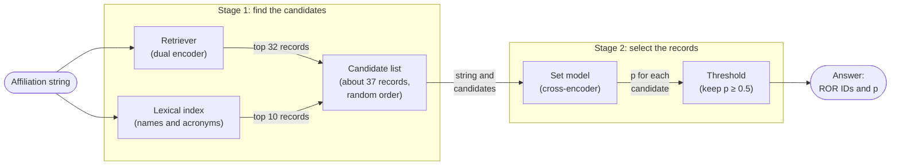

# ROR set point matching

ROR set point matching links affiliation strings to [ROR](https://ror.org) records. An affiliation string comes from a research paper, for example "Dept. of Physics, University of Tokyo, Japan". The matcher finds the set of ROR records that the string names. A string can name zero, one or more organizations.

The repository contains the code that trains the models, runs the matcher and evaluates it. The data and the trained models are on the Hugging Face Hub (see [Data and models](#data-and-models)).

## How the matcher works

The matcher has two stages. Stage 1 finds the candidates: a short list of ROR records that the string can name. Stage 2 reads the string and its candidates together, and selects the records that the string names.



### Terms

| Term | Meaning |
|---|---|
| ROR record | One organization in the ROR registry. The matcher knows the 143,284 active and inactive records of ROR data release v2.14 |
| Record text | The text of a ROR record that the models read: its names, acronyms, places, types, status and related records |
| Token | A unit of text, for example a word or a part of a word |
| Vector | A list of numbers that a model makes from a text. Texts with similar meanings get similar vectors |
| Candidate | A ROR record that stage 1 finds for a string. Stage 2 examines only the candidates |
| p | The probability, from the set model, that the string names a candidate |
| Calibrated | p is calibrated when it is equal to the frequency of correct answers. For example, 80% of the candidates with p = 0.8 are correct |
| Answer | The ROR IDs that the matcher gives for a string. An answer can be empty |

### Stage 1: find the candidates

The set model is too slow to read all 143,284 records for each string. Thus stage 1 uses two faster methods to find about 37 candidates.

The retriever is a dual encoder. Its base model is multilingual-e5-base. It changes the string and each record text separately into vectors. Thus the record vectors are made one time, and all strings use them. The retriever keeps the 32 records whose vectors have the highest dot product with the string vector. It finds records also when the string uses different words, for example a name in another language or script ([phase 3](docs/training-3-retriever.md)).

The lexical index finds records whose names or acronyms are in the string. Its code comes from openalex-affiliation-matcher v3.0.0. It reads the names, acronyms and places of the ROR records. It divides the string into windows of one or two segments, at commas and semicolons. A name matches a window when the window contains at least half the weight of the name's words. The weight of a word is its IDF (inverse document frequency). Rare words, for example "Tokyo", have a high weight. Frequent words, for example "University", have a low weight. Acronyms match as whole words with the same case. The index ranks the records by their matches. A record gets a bonus when the string contains one of its cities or countries. Records with the same score are in the order of a hash of the string and the ROR ID. Such ties are frequent, because many records have the same name. The index keeps the top 10 ([docs/inference.md](docs/inference.md#the-lexical-index)).

The lexical index finds exact names and acronyms that the retriever can miss. The retriever finds records whose names are not in the string, for example a translated or short name.

The candidate list starts with the 32 records of the retriever. The matcher then adds the lexical records that are not already in the list. It puts the list in a random order that depends only on the string. The set model trained on candidates in a random order. Thus the order does not tell it which method found a record. The set model can select only candidates. On the four test splits, the candidate list holds 97.6% to 99.4% of the correct links.

### Stage 2: select the records

The set model is a cross-encoder. Its base model is mmBERT-base. It reads the string and the record texts of all its candidates in one input: `[CLS] string [SEP] record 1 [SEP] record 2 [SEP] ...`. The encoder gives a vector for each token. Each of these vectors also contains information from the other parts of the input. For each candidate, a linear layer changes the mean of its token vectors into a score. Platt scaling then changes the score into a calibrated p ([phase 4](docs/training-4-set-model.md)).

The set model reads the candidates together. Thus it can learn rules that compare candidates. An example is "select the hospital, but not the university in the name of the hospital". A pair scorer reads one candidate at a time, so it cannot learn such rules.

The answer is every candidate with p ≥ 0.5. Because p is calibrated, these records are more probably correct than incorrect. An empty answer means that the matcher finds no organization in the string.

### The meaning of "set point"

The name comes from two parts of the matcher. The set model reads the candidates as one set. The point p = 0.5 separates the answer from the other candidates.

## Relationship to openalex-affiliation-matcher

[openalex-affiliation-matcher](https://github.com/ourresearch/openalex-affiliation-matcher) v3.0.0 is the matcher that OpenAlex has used since September 2026. ROR set point matching uses these parts of it:

- The lexical candidate generator. `src/ror_set_point/inference/lexical.py` adapts its code (MIT license). Here it reads the ROR records, and it has no bonus for the works count of an institution.
- Its institutions file (`models/institutions.jsonl.gz`). It maps OpenAlex institution IDs to ROR IDs, for the teacher judgments and for answers with OpenAlex institution IDs.
- Its teacher judgments: 3.8 million judgments of (string, institution) pairs by Jev, a decision model from TypeSafe AI.
- Its development and test samples of OpenAlex strings. The `openalex_sample` config holds them, relabeled under the same annotation guidelines as the other labeled strings of the dataset.

The design of this matcher is different in these ways:

| Part | openalex-affiliation-matcher v3.0.0 | ROR set point matching |
|---|---|---|
| Registry | OpenAlex institutions, each linked to a ROR record | ROR data release v2.14: all 143,284 active and inactive records. 3,215 of them have no OpenAlex institution |
| Identifiers | OpenAlex institution IDs | ROR IDs |
| Candidates | Four generators: lexical, dense search over name variants, similar strings in OpenAlex, and the stored top 5 of the 2023 model. About 18 for each string | A trained retriever over the full text of each ROR record (top 32), and the lexical generator over the names and acronyms of the ROR records (top 10). About 37 for each string |
| Scoring | A pair scorer reads one string and one candidate at a time | A set model reads one string and all its candidates at a time |
| Decision | A gradient-boosted chooser with 21 hand-made features, for example ROR parent and child links | The calibrated probability from the set model. There are no hand-made features |
| Training data | Teacher judgments for the pair scorer, and labeled samples for the chooser | Teacher judgments, synthetic strings in non-Latin scripts, and labeled strings |
| Services | The similar-strings generator needs the OpenAlex search index, which is not public | All parts use public files |
| Evaluation | Random OpenAlex strings and external sets | The same kinds of sets, and a split by institution. This split measures institutions that the training data does not contain |

## Results

The table gives exact match, precision and recall, in percent, on the test splits of the dataset. Exact match is the share of strings where the answer is exactly the set of records that the string names. Precision and recall are micro averages over ROR IDs. The scores come from `ror_set_point.evaluation.score`.

The table compares these systems:

- "v3.0.0, local" is openalex-affiliation-matcher v3.0.0 as anyone can run it: lexical and dense candidates, the pair scorer and the chooser. It does not have the two generators that need OpenAlex services, or the teacher. Its own benchmark figures are higher, because they come from the production answers and use other labels. It trained on some strings of `affiliations_unseen_institutions`, so its row there is not a measure of new institutions.
- "Baseline" uses the design of v3.0.0: the same candidate generators, a pair scorer and a chooser ([ror-set-point-pair-scorer-baseline](https://huggingface.co/adambuttrick/ror-set-point-pair-scorer-baseline)). Its pair scorer starts from the pair scorer of v3.0.0 and also trains on teacher pairs. On `affiliations_unseen_institutions`, the baseline trained on the train split of that config. On the other splits, it trained on the labeled strings of all institutions.
- "This matcher" is ROR set point matching with the released retriever and set model. Its answers come from `match run`.

| Test split | Strings | System | Exact match | Precision | Recall |
|---|---:|---|---:|---:|---:|
| `affiliations` | 1,947 | v3.0.0, local | 78.4 | 94.3 | 79.0 |
|  |  | Baseline | 86.1 | 96.1 | 88.1 |
|  |  | This matcher | 90.0 | 95.7 | 92.6 |
| `affiliations_unseen_institutions` | 1,957 | v3.0.0, local | 77.0 | 95.9 | 80.0 |
|  |  | Baseline | 79.2 | 93.6 | 85.1 |
|  |  | This matcher | 83.6 | 94.6 | 86.9 |
| `datacite` | 3,000 | v3.0.0, local | 92.4 | 97.7 | 93.2 |
|  |  | Baseline | 91.9 | 95.1 | 95.6 |
|  |  | This matcher | 93.5 | 98.0 | 94.5 |
| `openalex_sample`, sample v1 | 20,000 | v3.0.0, local | 81.6 | 95.3 | 83.2 |
|  |  | Baseline | 86.9 | 95.6 | 90.0 |
|  |  | This matcher | 89.9 | 96.1 | 92.1 |
| `openalex_sample`, sample v2 | 20,000 | v3.0.0, local | 82.6 | 94.9 | 84.2 |
|  |  | Baseline | 88.0 | 95.2 | 91.5 |
|  |  | This matcher | 90.4 | 95.7 | 93.3 |

- On the 1,755 links of `affiliations_unseen_institutions` test to held-out institutions, recall is 89.6 for this matcher and 86.3 for the baseline. On the validation split, recall is 78.7 and 84.9. The cause is CNRS: this matcher often misses it when a string names it only with its acronym. Without the CNRS strings, recall is 86.5 and 83.5. No training row of the released models has a held-out institution as a positive.
- On `affiliations` test, this matcher is right on 150 strings where the baseline is wrong. It is wrong on 74 strings where the baseline is right (exact McNemar p = 4 × 10⁻⁷). On `affiliations_unseen_institutions` test, the counts are 170 and 82 (p = 3 × 10⁻⁸).
- No model, setting or training-data rule comes from the scores on a test split. The `affiliations_unseen_institutions` test split is a pass-or-fail check for the retriever and for the set model. `openalex_sample` test and `datacite` also have scores for information only, in addition to the final scores.

[docs/evaluation.md](docs/evaluation.md) gives more results and the procedure.

## Repository layout

```
src/ror_set_point/
  common/               files, text rules, ROR records, training exclusions
  training/data/        phase 1: the records folder, teacher judgments, the split by institution
  training/synthetic/   phase 2: synthetic strings in non-Latin scripts
  training/retriever/   phase 3: the retriever
  training/set_model/   phase 4: the set model
  inference/            the lexical index, the retriever, the set model and the matcher
  evaluation/           scores, candidate recall, error classes and statistics
docs/                   one document for each training phase, for inference, for evaluation and for Jobs
jobs/                   scripts that run the pipeline as Hugging Face Jobs
tests/                  unit tests
```

## Install

The project uses [uv](https://docs.astral.sh/uv/). Run this command in the repository folder:

```
uv sync
```

The versions of torch (2.6.0), transformers (4.57.6) and sentence-transformers (5.1.2) are fixed. These are the versions that trained the released models. Training needs one CUDA GPU. Inference also runs on a CPU, but a GPU is much faster.

On a Linux CUDA GPU, install the `gpu` extra for fast inference:

```
uv sync --extra gpu
```

It adds flash-attn 2.7.4 (a prebuilt wheel for torch 2.6 and Python 3.12). The set model then puts the inputs of a batch one after the other with no padding, and runs flash-attention on each input. On 1 × NVIDIA H200 it answers 753 strings each second, 5.6 times as many as without the extra, with the same accuracy ([docs/inference.md](docs/inference.md#the-set-model-on-a-cuda-gpu)).

Run the unit tests with `uv run pytest`.

The commands in this README and in `docs/` read and write files in the current folder. Run them in the root folder of the repository. `.gitignore` ignores the files and folders that they write.

## Quick start

These steps match a file of strings with the released models. [docs/inference.md](docs/inference.md) gives the details.

1. Download the records folder of the dataset (the ROR records and their maps):

   ```
   hf download adambuttrick/ror-set-point-matching-train-validation-test --repo-type dataset \
       --include "data/ror_records/*" --local-dir dataset
   ```

2. Match the strings. The input is a JSON Lines file with the fields `id` and `text`, or a text file with one string on each line:

   ```
   uv run python -m ror_set_point.inference.match run --input strings.jsonl --records dataset/data/ror_records \
       --retriever adambuttrick/ror-set-point-retriever-e5-base \
       --set-model adambuttrick/ror-set-point-set-model-mmbert-base --record-vectors record_vectors.pt \
       --out answers.jsonl
   ```

Each output row is `{"id": ..., "ror_ids": [...], "p": [...]}`.

### On Hugging Face Jobs

The scripts in `jobs/` run the same steps as Hugging Face Jobs, with the outputs in a bucket ([docs/jobs.md](docs/jobs.md)). For example, this job makes the records folder and the index, and matches a file that is in the bucket:

```
jobs/submit.sh pipeline --flavor h200 --timeout 3h --attempts 3 \
    -e INPUT=/bucket/inputs/strings.jsonl -e OUT=/bucket/runs/my-run/answers.jsonl
```

## Training

Training has four phases. Each phase reads the output of the phases before it. The dataset contains the outputs of phases 1 and 2, so you can start at phase 3.

| Phase | Document | Output | Compute for the released models |
|---|---|---|---|
| 1. Data | [docs/training-1-data.md](docs/training-1-data.md) | The records folder, `teacher_judgments`, `affiliations_unseen_institutions` | CPU, a few minutes |
| 2. Synthetic strings | [docs/training-2-synthetic.md](docs/training-2-synthetic.md) | `synthetic_non_latin` | 816 calls to a language model, about 3.5 hours |
| 3. Retriever | [docs/training-3-retriever.md](docs/training-3-retriever.md) | The retriever, and its top 64 records for each string | A first pass on 1 × NVIDIA L4 (1.8 hours), then 1 × NVIDIA H200 (17 minutes) |
| 4. Set model | [docs/training-4-set-model.md](docs/training-4-set-model.md) | The set model and its calibration | 1 × NVIDIA H200, 2.8 hours |

## Evaluation

[docs/evaluation.md](docs/evaluation.md) tells how to score answers, measure candidate recall and classify errors. It also gives the rules for the evaluation splits.

## Data and models

| Repository | Content |
|---|---|
| [ror-set-point-matching-train-validation-test](https://huggingface.co/datasets/adambuttrick/ror-set-point-matching-train-validation-test) (dataset) | Labeled strings, evaluation sets, teacher judgments, synthetic strings, and the ROR records with their two maps (`data/ror_records` is a records folder) |
| [ror-set-point-retriever-e5-base](https://huggingface.co/adambuttrick/ror-set-point-retriever-e5-base) | The retriever |
| [ror-set-point-set-model-mmbert-base](https://huggingface.co/adambuttrick/ror-set-point-set-model-mmbert-base) | The set model |
| [ror-set-point-pair-scorer-baseline](https://huggingface.co/adambuttrick/ror-set-point-pair-scorer-baseline) | The baseline |
| Variants | `ror-set-point-retriever-e5-base-no-synthetic`, `ror-set-point-retriever-embeddinggemma-300m`, `ror-set-point-set-model-bge-reranker-v2-m3`, `ror-set-point-set-model-embeddinggemma-300m` |

Each model repository contains its training folder (`training_data/`), in the format that the training scripts read and write, and its outputs on the evaluation splits.

## Licenses of the parts

| Part | License |
|---|---|
| `src/ror_set_point/inference/lexical.py` | MIT, from openalex-affiliation-matcher (the notice is in the file) |
| ROR records | CC0 |
| OpenAlex strings and institutions | CC0 |
| Retriever weights | MIT, from multilingual-e5-base |
| Set model weights | MIT, from mmBERT-base |
